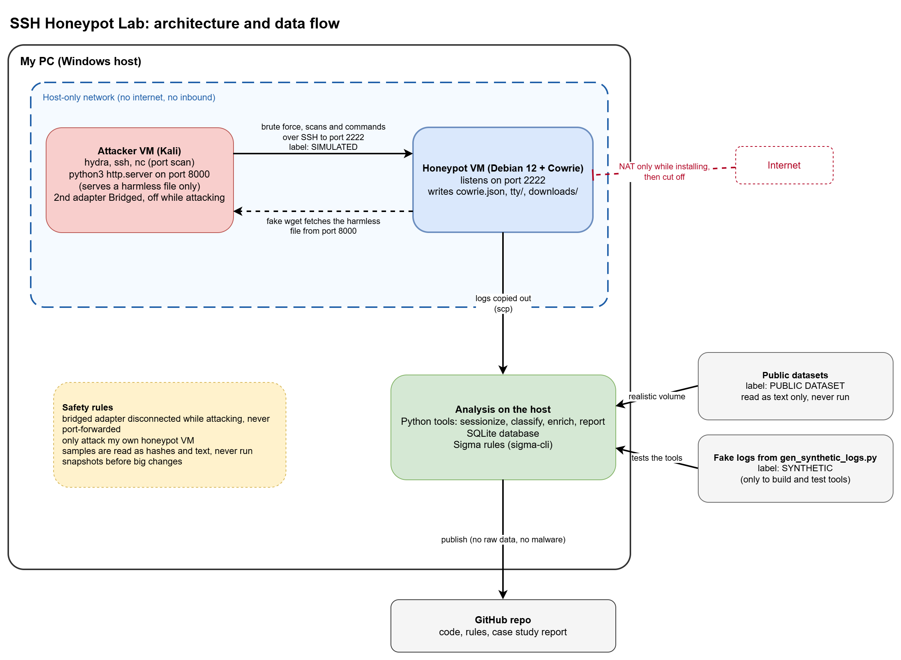

# Architecture and Flow

## Setup

I have a Windows host machine and inside it there are 2 VMs.

## Attacker VM

One is the attacker Kali. From there I will use hydra and ssh and nc to perform the attacks. I will also run a small python http.server with a harmless file on it so the fake wget inside the Cowrie shell has something to fetch. It is bound to the host-only address only.

## Honeypot VM

The other is a Debian machine. I install it first with internet through NAT and then cut the internet off. Cowrie is set up on this Debian VM and listens on port 2222. Everything the attacker does is logged there in `cowrie.json` and `tty/` and `downloads/`. Cowrie has its own login rules in `userdb.txt` so only two accounts get in and every other login is refused.

## Network

Both VMs are on a host-only network. The Debian one has no internet as I will be attacking it in a local environment. The attacker VM reaches it over that host-only network. Kali also keeps a second adapter that is Bridged and I disconnect it before the attacks.

## Analysis

I copy the logs from the Debian VM to my host with scp. Then I run scripts on the host to clean and analyze the data and to test them.

## Datasets

I will get some public datasets too and generate fake ones with Python too. I label all data as SIMULATED or PUBLIC DATASET or SYNTHETIC.

## Publishing

Then I do a case study analysis and publish it on GitHub.

## Diagram

